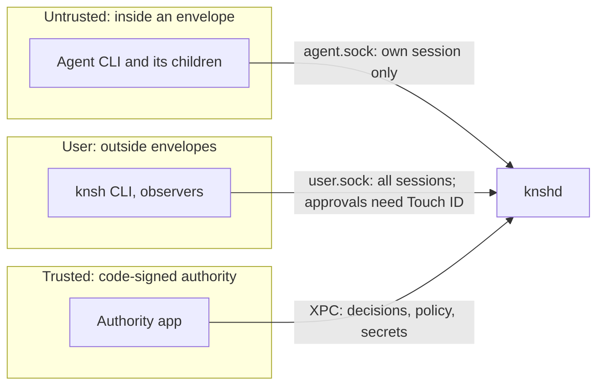

# Endpoints and trust boundaries

`knshd` exposes three endpoints. Which one a caller can reach determines what it can do; the sandbox profiles, not the endpoints themselves, keep agents away from the privileged ones.

| Endpoint | Transport | Who can reach it | Used for |
| --- | --- | --- | --- |
| `agent.sock` | Unix socket created by launchd | Processes inside envelopes | Running commands, the session's own records and checkpoints, policy dry runs |
| `user.sock` | Unix socket created by launchd | User processes outside envelopes; every envelope profile denies it | Starting agent sessions, human history and undo, approvals, policy edits, read-only observers |
| Control | XPC Mach service | Only the trusted, code-signed authority; every envelope profile denies the lookup | Decisions, policy push, grants, session control, secrets |

## Trust levels

- `agent.sock` is scoped to the caller's session. A request without a valid session token is matched to its envelope through the caller's audit token; if that fails, it is refused.
- `user.sock` actions that change security state (approvals, policy edits, grants, profile selection) require Touch ID or the user's password, checked by `knshd` itself. The CLI cannot claim the user is present.
- The control service accepts only the trusted authority, verified by code signature in both directions ([authority](../functional-requirements/authority.md)).
- Engine paths, `user.sock` and the control service lookup are fixed denies in every envelope and command profile; no profile can change that.

Method lists for each endpoint are in [../api/](../api/README.md).
