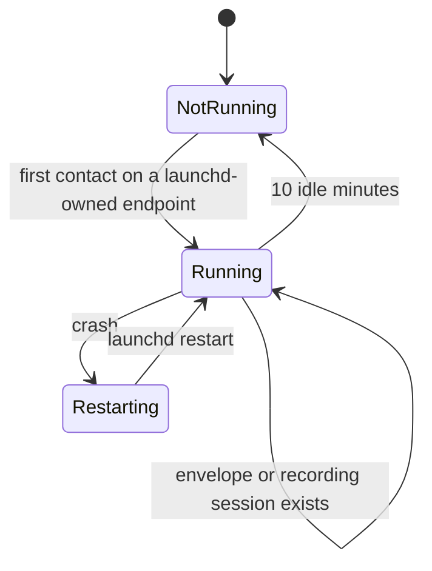

# Process model

## `knshd` lifecycle

- `knshd` is a **launchd user agent** (label `knsh.knshd`, installed by `knsh daemon install`, see [CLI](../06-api/cli.md#daemon-installation)). launchd creates both sockets and the XPC service before `knshd` runs, starts it on first contact, and no other process can claim those names.
- `knshd` takes its sockets from launchd (`launch_activate_socket`) and never binds one itself; started any other way, it exits with an error.
- `knshd` serves a `user.sock` connection only if the peer's effective uid (`getpeereid`) equals its own; any other peer, or one whose credentials cannot be read, is disconnected.
- `knshd` stays alive while any envelope or recording session exists, and launchd restarts it if it crashes.
- It exits after **10 idle minutes**.
- Grants and pushed policy are kept in its state store and survive restarts; secrets supplied by the authority are memory-only and are lost on exit.
- Human sessions with recording off never start `knshd`.
- If `knshd` cannot be reached, no agent command runs (there is no supervisor), and human sessions continue normally ([reliability](../04-non-functional-requirements/reliability.md)).
- **One process per user:** `knshd` runs with the user's permissions, has no root privileges, and never serves another macOS user.

## Data locations (macOS)

| Data | Path |
| --- | --- |
| Configuration and policy files | `~/.config/knsh/` (integrity-protected, see [policy](../03-functional-requirements/policy.md)) |
| Records, grants, pushed policy | `~/Library/Application Support/knsh/` |
| Checkpoints | `~/Library/Application Support/knsh/checkpoints/` for the home volume; a writable `.knsh-checkpoints/` folder on other APFS volumes, otherwise plain copies in the home store |
| Sockets | `~/Library/Application Support/knsh/run/agent.sock` and `user.sock` |
| Control service | XPC Mach service `knsh.control` (final name tied to the signing identity) |
| System log | Unified logging subsystem `knsh` |

- All engine paths are denied to every envelope and excluded from Spotlight and Time Machine.
- Checkpoints sit on the same volume as the files they protect, because copy-on-write clones only work within one APFS volume.

The full list is in [../09-reference/file-locations.md](../09-reference/file-locations.md).
