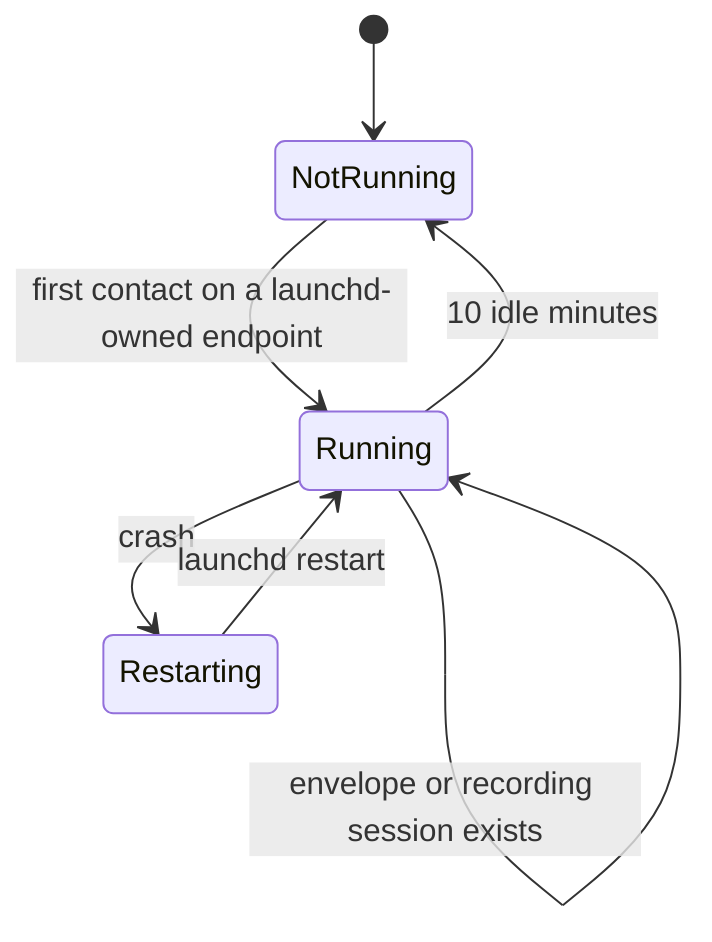

# Process model

## `knshd` lifecycle

- `knshd` is a **launchd user agent** (label `knsh.knshd`, installed by `knsh daemon install`, see [CLI](../06-api/cli.md#daemon-installation)). launchd creates both sockets and the XPC service before `knshd` runs, starts it on first contact, and no other process can claim those names.
- `knshd` takes its sockets from launchd (`launch_activate_socket`) and never binds one itself; started any other way, it exits with an error.
- `knshd` serves a `user.sock` connection only if the peer's effective uid (`getpeereid`) equals its own; any other peer, or one whose credentials cannot be read, is disconnected.
- `knshd` stays alive while any envelope or recording session exists, and launchd restarts it if it crashes.
- It exits after **10 idle minutes**.
- Serving: one thread waits on kqueue for connections; each connection gets its own thread, so a slow client blocks only itself. Connections are bounded (see [defaults and limits](../09-reference/defaults-and-limits.md)) and excess ones are closed on accept. A client must send `hello` first, within a bounded time.
- Exiting, idle or on `SIGTERM` from launchd: `knshd` stops accepting, lets in-flight requests finish within a grace period, closes every connection, commits pending record writes, and exits with status 0. launchd does not restart it then; the next connection starts it again.
- Grants and pushed policy are kept in its state store and survive restarts; secrets supplied by the authority are memory-only and are lost on exit.
- Human sessions with recording off never start `knshd`.
- If `knshd` cannot be reached, no agent command runs (there is no supervisor), and human sessions continue normally ([reliability](../04-non-functional-requirements/reliability.md)).
- **One process per user:** `knshd` runs with the user's permissions, has no root privileges, and never serves another macOS user.



## `knsh-exec`

`knsh-exec` is the only way an agent command or envelope starts (KNSH-046). `knshd` is multithreaded, so it never
applies a sandbox between `fork` and `exec` itself; it spawns `knsh-exec`, which is single-threaded, depends on the
standard library only (NFR-SUP-01), and becomes Apple's `sandbox-exec` (decision 1).

```text
knsh-exec [--keep-fd <n>]... [--status-fd <n>] --profile <absolute path> --interpreter <absolute path>
          --line <line> [--arg <operand>]...
  => execve("/usr/bin/sandbox-exec", ["/usr/bin/sandbox-exec", "-f", <profile>, <interpreter>, "-c", "--", <line>,
            <operand>...], env)

knsh-exec [--keep-fd <n>]... [--status-fd <n>] [--in-group] --profile <absolute path> --program <absolute path>
          [--arg <argument>]...
  => execve("/usr/bin/sandbox-exec", ["/usr/bin/sandbox-exec", "-f", <profile>, <program>, <argument>...], env)
```

**Program mode (KNSH-108).** With `--program` instead of `--interpreter` and `--line`, the program itself runs under
the profile with the `--arg` values as `argv[1..]` (its `argv[0]` is its path): one simple command of a native-mode
line, or the native interpreter of such a line ([command lifecycle](../03-functional-requirements/command-lifecycle.md#native-mode-knsh-108)).
`--program` excludes `--interpreter` and `--line`, and one of the two modes is required. `--in-group` skips
`setpgid(0, 0)`: `knshd` has already placed the process in the line's process group before it executed `knsh-exec`.

- **Arguments.** `--profile`, and either `--program` or both `--interpreter` and `--line`, are each required exactly once, in any order; `--keep-fd`
  (a descriptor number of 3 or more, at most 16, no repeats) is optional. `--arg` (at most 4096, in order) passes
  the line's operands, which the interpreter sees as `$0`, `$1`, … (KNSH-051). `--status-fd` (at most once, a
  descriptor number of 3 or more that is not also kept) names where a failure is reported (below). Paths must be
  absolute with no `.`, `..` or empty components; the line must not be empty. Any other argument, a repeated option or a missing value is
  rejected. Error messages never repeat a value. `--` after `-c` makes a line that starts with `-` a command, never
  an interpreter option (`/bin/sh`, `/bin/bash` and `/bin/zsh` all accept it).
- **Profile file.** A regular file (not a symlink) owned by the user and not writable by group or others, as `knshd`
  writes it (FR-SBX-07); anything else is refused before `sandbox-exec` reads it.
- **Process.** `setpgid(0, 0)`, so the line leads its own process group. Every open descriptor except 0, 1, 2 and
  those named with `--keep-fd` gets `FD_CLOEXEC`; closed stdio or a named descriptor that is not open is refused.
  `SIGPIPE` is reset to its default action (the Rust runtime ignores it, and ignored signals survive `execve`). The
  thread count must be exactly 1 just before `execve`. The environment is passed on as received: `knshd` builds it.
- **Exit codes** (`<sysexits.h>`), each with one `knsh-exec: <reason>` line on stderr, and nothing run:

  | Code | Meaning |
  | --- | --- |
  | 64 | Malformed arguments, including a `--keep-fd` descriptor that is not open |
  | 66 | The profile file is missing or unsafe |
  | 69 | `execve` of `/usr/bin/sandbox-exec` failed (for example, it is missing) |
  | 71 | Process setup failed (process group, descriptors, signals, more than one thread), or no sandbox backend on this platform |

  With `--status-fd`, every failure after the arguments were read also writes its exit code as one byte to that
  descriptor. The descriptor is never kept across the exec, so the supervisor reads end of file with no byte exactly
  when `sandbox-exec` started, and tells a trampoline failure from a line that exits with the same code (KNSH-051).

  `sandbox-exec` itself exits 65 when it cannot read or compile the profile and 71 when it cannot execute the
  interpreter, before the line starts. Those two exits cannot be told from a line's own 65 or 71, and are reported as
  the line's exit code; the profile is the compiler's deterministic output and the interpreters are always allowed,
  so neither is expected. There is never a fallback to running the line unsandboxed: the supervisor treats each of
  these exits as a deny, and the capability probe reports `sandbox: none`
  ([capabilities](../05-models/capabilities.md#probe)).

## Data locations (macOS)

| Data | Path |
| --- | --- |
| Configuration and policy files | `~/.config/knsh/` (integrity-protected, see [policy](../03-functional-requirements/policy.md)) |
| Records, grants, pushed policy | `~/Library/Application Support/knsh/` |
| Checkpoints | `~/Library/Application Support/knsh/checkpoints/` for the home volume; a writable `.knsh-checkpoints/` folder on other APFS volumes, otherwise plain copies in the home store |
| Sockets | `~/Library/Application Support/knsh/run/agent.sock` and `user.sock` |
| Control service | XPC Mach service `knsh.control` (final name tied to the signing identity) |
| System log | Unified logging subsystem `knsh` |

- All engine paths are denied to every envelope and excluded from Spotlight and Time Machine.
- Checkpoints sit on the same volume as the files they protect, because copy-on-write clones only work within one APFS volume.

The full list is in [../09-reference/file-locations.md](../09-reference/file-locations.md).
