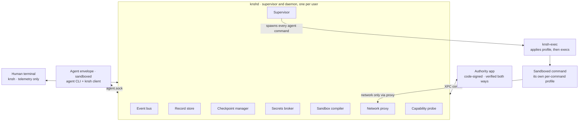

# System overview

Kinetic Shell has three binaries:

- `knshd` is the per-user daemon and the **supervisor**: it decides on and spawns every shell command an agent issues.
- `knsh` is the human's interactive shell and, inside an agent's envelope, a thin client that forwards commands to the supervisor.
- `knsh-exec` is a small single-threaded trampoline that applies a sandbox profile and then runs the command.

The envelope and each command are sandboxed. The envelope confines the agent CLI and anything it runs directly; commands it issues through the shell run outside the envelope under their own profile, started only by the supervisor. See [enforcement-model.md](enforcement-model.md).

## Components

| Component | Lives in | Responsibility | Specified in |
| --- | --- | --- | --- |
| Interactive front end | `knsh` | Hosts stock zsh or bash for humans (integration mode) and records their commands as telemetry. A native interpreter arrives in phase 4. | [sessions](../functional-requirements/sessions.md), [terminals and shells](../integrations/terminals-and-shells.md) |
| Agent client | `knsh` | Inside an envelope, `knsh -c` and the `sh`/`bash`/`zsh` shims forward the command line, working directory, environment and stdio descriptors to the supervisor, then return its exit code. | [agent integration](../functional-requirements/agent-integration.md) |
| Supervisor | `knshd` | Parses and classifies agent command lines, runs hooks, evaluates policy, asks the authority, and spawns each command through `knsh-exec`. | [command lifecycle](../functional-requirements/command-lifecycle.md) |
| Sandbox compiler | `knshd` | Builds a deny-by-default Seatbelt profile for each envelope and each command. | [sandbox profiles](../functional-requirements/sandbox-profiles.md) |
| Network proxy | `knshd` | Local HTTP and SOCKS proxy with per-command identity, host rules and address checks. | [network proxy](../functional-requirements/network-proxy.md) |
| Event bus | `knshd` | Fans events out to subscribers. | [events](../functional-requirements/events.md) |
| Record store | `knshd` | SQLite database of execution records, with retention and redaction. | [execution records](../functional-requirements/execution-records.md) |
| Checkpoint manager | `knshd` | Shadow trees, checkpoints and the undo/redo history. | [checkpoints](../functional-requirements/checkpoints.md) |
| Secrets broker | `knshd` | Resolves secrets from the Keychain or the authority and injects them into approved commands. | [secrets](../functional-requirements/secrets.md) |
| Capability probe | `knshd` | Detects which sandbox, checkpoint and secret backends work on this machine. | [capabilities](../models/capabilities.md) |
| Trampoline | `knsh-exec` | Receives a compiled profile, applies it, then executes the resolved command. | [enforcement model](enforcement-model.md) |

## Related

- [endpoints.md](endpoints.md) — how clients reach `knshd`
- [process-model.md](process-model.md) — how `knshd` starts, stops and stores data
