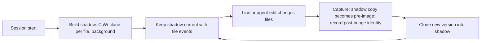

# Checkpoints: best-effort undo and redo

Checkpoints make most agent file changes reversible. They are best-effort: the engine detects when it cannot be sure what a file should be, and then refuses to restore rather than overwrite something it did not record. Data structures are in [../models/checkpoint.md](../models/checkpoint.md).

## Taking checkpoints

| ID | Requirement |
| --- | --- |
| FR-CKP-01 | **Shadow:** when an agent session starts, `knshd` must build a shadow of each checkpoint root by cloning file by file with copy-on-write, in the background. |
| FR-CKP-02 | While `checkpoints.required = true`, agent lines that touch a root must wait until its shadow is complete, or fail with `-32010` if the caller does not wait. |
| FR-CKP-03 | **Keeping current:** file-system events must keep the shadow in step with the live tree. |
| FR-CKP-04 | When the system reports dropped events, the affected folder must be rescanned, and checkpoints taken in that window must be marked **uncertain** (`checkpoint.uncertain`). |
| FR-CKP-05 | **Attribution:** changes made while a supervised line runs must be attributed to it (`command`). |
| FR-CKP-06 | Changes made inside an envelope outside any supervised line must become **agent edits** (`agent_edit`) and emit `agent.edit`. |
| FR-CKP-07 | Overlapping lines in one root must form a **concurrent set** (`concurrent`), undone together. |
| FR-CKP-08 | **Capture:** after each line or agent edit, for every changed path the shadow copy must move into the checkpoint as the pre-image (or a marker that the file did not exist). |
| FR-CKP-09 | The engine must record a **post-image identity** for each changed path: inode, size, modification time, and a content hash for files under 64 MB. The new version is then cloned into the shadow. |
| FR-CKP-10 | Checkpoint cost must grow with the number of files changed, not with the size of the project. Nothing has to be predicted before a command runs. |
| FR-CKP-11 | `checkpoint.created` must be emitted for each checkpoint. |

File events carry no process ID, so a human edit made at the same moment can be attributed to the agent; the post-image check below keeps that from causing damage.

## Restore rules

| ID | Requirement |
| --- | --- |
| FR-CKP-20 | Undo and redo must restore a path only if the live file still matches its recorded post-image identity. Otherwise the path is a conflict and nothing changes (`-32004`). |
| FR-CKP-21 | `force` must exist only on `user.sock` and for the authority, never on `agent.sock`. |
| FR-CKP-22 | Restoring must write the old contents into the existing file, so its inode, hard links and open descriptors stay valid. |
| FR-CKP-23 | The modification time must be set to now, so build tools notice the change. |
| FR-CKP-24 | Files that were open for writing or memory-mapped during the change, and SQLite databases with journal files, must be marked **possibly torn** and not restored without `force`. |
| FR-CKP-25 | `checkpoint.restored` must be emitted after a restore. |

## History tree

States form a tree, like commits. Each line, agent edit or concurrent set is an edge from one state to the next. Undo moves back along an edge and keeps the branch it left, so redo stays possible until retention removes it.

| Operation | Effect | Endpoints |
| --- | --- | --- |
| `checkpoint.undo {record_id}` | Restores that change's pre-images, after saving the current versions so redo is possible | all (own session on `agent.sock`) |
| `checkpoint.redo {record_id}` | Restores the versions saved by the matching undo | all (own session on `agent.sock`) |
| `checkpoint.restore {state_id}` | Returns every root to an earlier state, undoing all later changes at once | `user.sock` and authority only |
| `checkpoint.diff {record_id \| state_id}` | Lists paths and returns per-file diffs between two states | all |

| ID | Requirement |
| --- | --- |
| FR-CKP-30 | Older changes may be undone only if no later change touched the same paths; otherwise the call must return the conflicting paths. |
| FR-CKP-31 | **Excluded paths** (`checkpoints.exclude`, default `node_modules`, `target`, `.venv`, `dist`, `build`) are not protected; undo must list them as not restored. |
| FR-CKP-32 | **Retention** must keep checkpoints until the first limit is reached: 5 GB of checkpoint data per volume, 200 checkpoints per root, or 7 days. |
| FR-CKP-33 | **Sensitive files:** pre-images of files matching sensitive patterns (`.env*`, `*.pem`, `*.key`, `id_*`) must be kept for 24 hours at most. |
| FR-CKP-34 | `knsh forget --with-checkpoints` must remove checkpoints at once. |
| FR-CKP-35 | **Other volumes:** checkpoints must sit on the same volume as the files they protect. Roots on non-APFS volumes must fall back to plain copies, limited to 50 MB per change, and the capability report must say so. |
| FR-CKP-36 | Undo of a flagged irreversible change must still restore its files, and its result must list what cannot be undone. |

Undoing an `npm install`, for example, leaves `node_modules` out of step with the lockfile until install runs again. A file the agent deleted, including one holding secrets such as `.env`, stays in its checkpoint until retention removes it.
