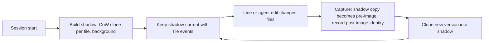

# Checkpoints: best-effort undo and redo

Checkpoints make most agent file changes reversible. They are best-effort: the engine detects when it cannot be sure what a file should be, and then refuses to restore rather than overwrite something it did not record. Data structures are in [../05-models/checkpoint.md](../05-models/checkpoint.md).

## Taking checkpoints

| ID | Requirement |
| --- | --- |
| FR-CKP-01 | **Shadow:** when an agent session starts, `knshd` must build a shadow of each checkpoint root by cloning file by file with copy-on-write, in the background. |
| FR-CKP-02 | While `checkpoints.required = true`, agent lines that touch a root must wait until its shadow is complete, or fail with `-32010` if the caller does not wait. |
| FR-CKP-03 | **Keeping current:** file-system events must keep the shadow in step with the live tree. |
| FR-CKP-04 | When the system reports dropped events, the affected folder must be rescanned, and checkpoints taken in that window must be marked **uncertain** (`checkpoint.uncertain`). |
| FR-CKP-05 | **Attribution:** changes made while a supervised line runs must be attributed to it (`command`). |
| FR-CKP-06 | Changes made inside an envelope outside any supervised line must become **agent edits** (`agent_edit`) and emit `agent.edit`. |
| FR-CKP-07 | Overlapping lines in one root must form a **concurrent set** (`concurrent`), undone together. |
| FR-CKP-08 | **Capture:** after each line or agent edit, for every changed path the shadow copy must move into the checkpoint as the pre-image (or a marker that the file did not exist). |
| FR-CKP-09 | The engine must record a **post-image identity** for each changed path: inode, size, modification time, and a content hash for files under 64 MB. The new version is then cloned into the shadow. |
| FR-CKP-10 | Checkpoint cost must grow with the number of files changed, not with the size of the project. Nothing has to be predicted before a command runs. |
| FR-CKP-11 | `checkpoint.created` must be emitted for each checkpoint. |

**Shadow builder (KNSH-079).** One build per root that clones (`apfs-clone`), started when the agent session starts
(`session.start_agent`, `session.create`) and stopped when it ends; session start never waits for it. Per decision 15
it clones file by file on 4 threads at QoS utility, into a new owner-only folder `shadows/<session>/<root index>/` in
the root's store. Every entry is read with `lstat`: a symlink is cloned as the link (its target is never read or
entered), a folder is entered only if it is one, folders named in `checkpoints.exclude` are skipped at any depth (files
of that name are not), special files (sockets, FIFOs, devices) are skipped and listed, and the store and the engine
directories are never entered (a root may contain them). An entry removed during the build is skipped; any other error
fails the build, and the root becomes `none`. Each build's file count and duration are logged, and one over 10 s is
logged as an error (NFR-PERF-06). Roots whose store is `plain-copy` get no shadow yet (`none`). Shadows are not removed
when their session ends yet (retention, KNSH-087).
**Known limit (pending):** the walk goes by path, so a folder swapped for a symlink between its `lstat` and its
listing (by a writer racing the build, such as the envelope) is still followed for that folder; an `openat`-relative
walk with `O_NOFOLLOW` closes this. Restore (KNSH-084) writes pre-images only to their own paths inside the root, so
such a race can at worst put content the user could already read into the root; it stays open until the walk is fixed.

**Lines that touch a root (FR-CKP-02).** A line touches a root when its `cwd` is in the root, or the profile's
`fs.write` holds a path in the root or one containing it: lines are sandboxed to `fs.write`, so a line meeting neither
cannot change the root. A required root that will never have a shadow denies the line before any waiting.

**Keeping current (KNSH-080, FR-CKP-03, FR-CKP-04, FR-EVT-08).** Each root with a shadow has one FSEvents stream
(file-level events, `WatchRoot`) on the root and on its marker folder `markers/<session>/<root index>/` in the root's
store, started **before** the shadow build so changes made while it runs are kept and applied once it completes, and
stopped when the session ends. The stream's thread only records which paths may have changed, coalesced to one entry
per path and at most 8,192 paths per root; more collapse into one rescan of the whole root (`too_many_events`). A
worker thread brings the shadow in step: each path's live entry and shadow copy are compared by kind, size and
modification time (flags are only hints, decision 16), a changed file or symlink is cloned again, a removed entry is
removed from the shadow (a folder with everything below it), a folder created or moved in is reconciled with
everything below it, and excluded folders, the store, the engine folders and special files are never shadowed. Each
path that really changed is published as `file.changed` on the session, whoever changed it (a removed folder
publishes itself and each entry that was below it). While the root itself is gone or not a folder, the shadow keeps
its last known state. Before a shadow copy is replaced or removed, capture takes it as the change's pre-image (below).

**Lost events (FR-CKP-04).** `MustScanSubDirs`, `UserDropped` or `KernelDropped` rescans the folder named (the root,
as observed); on the marker folder, `EventIdsWrapped` and `RootChanged` (after checking the root is still a folder)
rescan the whole root. Each starts a new **uncertain window**. A line takes the window when it starts and compares it
when it ends: if it moved, `checkpoint.uncertain` is published with the line's `record_id` after its
`command.finished`. A window that opens while no line runs is published at once with `record_id: null` (the agent
edits of that window). A shadow update that fails also makes the window uncertain (`shadow_update_failed`).

**Closing a line (decision 16).** Once the supervisor has reaped a line, for each protected root it touches, the
watcher creates a marker file in the marker folder and flushes the stream every millisecond until the marker's event
arrives (so every earlier event of the line has too), a drop arrives, or 1 s passes on the clock; it then waits, within
the same second, until the worker has applied everything received. A drop, a missing marker (`flush_timed_out`) or a
root without a running watcher (`not_watched`) makes the line's checkpoints uncertain. This is the only place the
decision path waits for the watcher.

**Restart (NFR-REL-04).** A watcher can take over a shadow an earlier `knshd` run left: it rescans the whole root
against it and publishes the gap as `checkpoint.uncertain` (`restart_gap`). **Pending:** sessions do not survive a
`knshd` restart yet, so `knshd` has no shadow to take over after one; the takeover is wired when agent sessions are
re-adopted after a restart.

**Attribution (KNSH-081, FR-CKP-05 to FR-CKP-07).** `knshd` keeps one attribution ledger for all sessions, keyed by
root, so a line of one session in a root another session also protects is never the other's agent edit. Each change
the watcher applies is attributed by when it was applied and which root it is in:

| While | Attribution | Edge |
| --- | --- | --- |
| One supervised line runs in the root | `command` | That line's; closes when it ends |
| Two or more lines overlap in time in the root | `concurrent` | One set holding every overlapping line, transitively and across roots through a line touching several; closes when the last of them ends, and is undone as one |
| No line runs, and an envelope session protects the root | `agent_edit` | One run of agent edits; closes when the next line in the root starts or the last envelope session ends. Each batch the watcher applies is published as `agent.edit {root, paths, omitted}` on each envelope session protecting the root, at most 256 paths per event |
| No line runs, and no envelope session protects the root (only `session.create` sessions) | `external` | One run; closes when an envelope session or a line arrives, or the last session protecting the root ends; never offered for agent undo |

A change reported once no session protects the root and no line runs there (the last batch of a watcher stopped with
its session) belongs to nobody and is dropped. When sessions share a root, each has its own watcher and each reports a
line's changes: the line-end procedure therefore also flushes the other sessions' watchers of the line's roots (within
the flush deadline each, their uncertainty staying their own), so none reports a change of the line after it ended.

A line's record gets its `attribution` (`command` or `concurrent`) only after the line-end procedure has applied every
event of the line, so it is final and always equals the attribution of the closed edge that holds the line. A denied
line has none. An edge lists at most 65,536 paths and is then marked overflowed. Each edge's changes are captured as
its checkpoint (below); the history tree model exists (KNSH-083, below), but feeding closed edges into it is wired
with undo (KNSH-084), and until then closed edges themselves are dropped.
**Known limit:** opening a line never waits for the watcher (decision 16), so a change made just before the line whose
event had not been applied yet is attributed to the line.

File events carry no process ID, so a human edit made at the same moment can be attributed to the agent; the post-image check below keeps that from causing damage.

**Capture (KNSH-082, FR-CKP-08 to FR-CKP-11).** One checkpoint per edge that changed something, identified by
`checkpoint_id`:

- **Pre-images.** Before the watcher replaces or removes a file's or symlink's shadow copy, it **moves** it (a rename on
  the store's volume, never a copy) into the root's holding folder `held/<session>/<root index>/` in the store, then
  into the checkpoint's own folder `checkpoints/<checkpoint id>/`. A path the shadow did not hold gets the "did not
  exist" marker, a folder a folder marker; a removed folder lists itself and every entry below it, each with its own
  pre-image. The first pre-image of a path in an edge is kept (what it held before the edge); later changes of it in
  the same edge only update its post-image, and their intermediate copies are removed. A path created and removed
  within one edge is not listed.
- **Post-image identity.** Right after the shadow follows a changed path, the live path's inode, size and modification
  time are read, and a SHA-256 of its contents for regular files under 64 MiB (read between two identity reads that
  must agree); a deleted path has a "deleted" post-image.
- **Cost.** Only changed paths are touched (a few renames and one hash each); nothing walks the root and nothing is
  predicted before a line runs.
- **Uncertain, never wrong.** A copy that cannot be moved aside is removed as before (the shadow stays consistent) and
  its pre-image is *lost*; a new version that cannot be cloned puts the held copy back so the shadow keeps its last
  known state; a post-image that cannot be read is *unknown*. Each marks the checkpoint uncertain (`capture_failed`),
  as do the line's uncertain roots (FR-CKP-04) and an uncertain window outside lines, for the run of edits it opens.
  A checkpoint lists at most 65,536 paths, then is uncertain (`too_many_events`).
- **`checkpoint.created`** is published when the edge closes and every change of it has been added, on each session
  of the edge and each session whose watcher reported one of its changes. A line's record carries the checkpoint's
  `checkpoint_id` and `files_changed` (at most 256 paths with their post-image identities; the checkpoint holds them
  all); `exec.run` returns the full count. A line that touched a protected root but changed nothing has
  `files_changed` 0 (`[]` in the record) and no checkpoint, unless one of its roots was uncertain (it then gets an
  empty, uncertain checkpoint, so its record says changes may be missing); one that touched none has `null`. A line of a concurrent
  set that ends before the set closes gets the set's changes so far.
- **Excluded folders (FR-CKP-31, KNSH-084).** The watcher reports the outermost excluded folder of each event path
  below one (or of an event on an excluded folder itself), and the checkpoint lists it, at most 256 per checkpoint
  (then marked incomplete), so an undo can name it as not restored. Excluded changes alone make no checkpoint.
- **Pending:** `captures` keeps only a summary of the last 64 checkpoints, and their pre-images on disk; the full
  checkpoints and the history tree (KNSH-084's `History`) live in memory, are written to disk with retention
  (KNSH-087), and are fed and called by `knshd` with the endpoints (KNSH-088). Plain-copy roots (which have no shadow
  yet) are not captured.
- **Known limit (sessions sharing a root):** each session's watcher reports every change in the root. If one of them
  applies a change after the next line has started (the KNSH-081 limit), that change can be captured in the line's
  checkpoint with that watcher's older shadow copy as its pre-image, so undoing the line could also undo the agent edit
  before it. One capturing watcher per root, or flushing peer watchers when a line starts, closes this (KNSH-084).

## Restore rules

| ID | Requirement |
| --- | --- |
| FR-CKP-20 | Undo and redo must restore a path only if the live file still matches its recorded post-image identity. Otherwise the path is a conflict and nothing changes (`-32004`). |
| FR-CKP-21 | `force` must exist only on `user.sock` and for the authority, never on `agent.sock`. |
| FR-CKP-22 | Restoring must write the old contents into the existing file, so its inode, hard links and open descriptors stay valid. |
| FR-CKP-23 | The modification time must be set to now, so build tools notice the change. |
| FR-CKP-24 | Files that were open for writing or memory-mapped during the change, and SQLite databases with journal files, must be marked **possibly torn** and not restored without `force`. |
| FR-CKP-25 | `checkpoint.restored` must be emitted after a restore. |

**Undo and redo (KNSH-084).** `knsh_checkpoint::History` holds the history tree and every checkpoint it refers to;
`undo` and `redo` take the change (by `record_id` or checkpoint), the caller (agent session, user or authority) and
`force`:

1. **Who.** `force` from an agent is refused before anything else (FR-CKP-21). An agent may undo or redo only a change
   of its own session, never external edits.
2. **Plan.** The history tree plans a step back, a step forward or a revert (below); nothing changes yet.
3. **Check every path, change nothing.** Each path of the checkpoint to restore must hold what the change left there:
   same kind, inode, size and modification time, and the same SHA-256 where one was recorded (so a write through a
   mapping is caught); a folder by kind and inode only (its time moves with its entries). A mismatch is a conflict
   (`changed`, `missing`, `exists`, or `unverifiable` when the post-image could not be read). So is a version that was
   never captured (`pre_image_lost`), a folder that would be removed while it holds entries the change did not record
   (`folder_not_empty`), and a path whose folder will not exist (`parent_missing`). Any conflict refuses the whole
   undo with `-32004` listing every conflicting path and reason, and nothing is written (no partial restore).
   `force` (user and authority only) overrides the first four, never the last three. Every folder from the root down
   to each path must be a real folder or one the undo puts back (`parent_missing` otherwise): `knshd` is not sandboxed,
   so a folder an agent swapped for a symlink must never let a restore write outside the root. This is checked again
   right before each path changes; being by path, it leaves the same instant-wide race as the shadow builder's walk.
4. **Save the current versions.** Each live file or symlink about to be replaced is cloned into a new checkpoint in
   the root's store; these are what redo restores, and what a failed restore is put back from.
5. **Restore**, in path order: first remove, deepest first, what must go; then put back folders and files, shallowest
   first. A file's old contents are written **into the existing file** (same inode, so hard links and open
   descriptors see them, FR-CKP-22), after checking again on the open descriptor that it is still the file checked;
   a path with nothing there gets a clone. Every restored file's modification time is set to now (FR-CKP-23).
6. **Commit and report.** The tree records the restore; for an undo the saved versions stay for redo, for a redo they
   are removed. The result lists the paths restored, the excluded folders the change touched as not restored
   (FR-CKP-31), and what the change did that cannot be undone (FR-CKP-36, its files are still restored);
   `checkpoint.restored` is published on each session of the change (FR-CKP-25). The restored files were rewritten
   (new times), so each checkpoint a later undo or redo checks them against (the newest change of each path still on
   the way to the head, and the saved versions of each change the head stepped back from) gets their new identities
   as post-images, but only where it recorded the same contents (kind, size and SHA-256): two changes of one file can
   be undone in turn, and an edit the history never recorded still conflicts.

**Never mixed (journal).** Several files cannot be replaced in one step, and a write in place is not atomic. Before
the first live path changes, a journal listing each path and its version before the restore (absent, folder, or the
saved copy) is written atomically to `restores/<saved id>.json` in each store involved. If any step fails, every path
already touched is put back from the saved copies (a half-written file is written over in full), then the journal and
the copies are removed. If `knshd` stops part-way, the journal is still there and `recover_restores` puts every listed
path back at the next start, before sessions use the root, then removes the journal before the copies it points at
(only `<id>.json` files are journals; a temporary file of an interrupted journal write is ignored). The journal is removed only once every path is restored;
if that fails, the restore is put back too, so a recovery never undoes a restore reported as done. Every failure thus
ends with every file as it was before the undo or redo.

**Limits.** Recovery writes the saved copies over whatever is at the listed paths, so a human edit made between a
crash and the next start is overwritten there. A special file (socket, FIFO, device) is replaced only under `force`
and cannot be put back by a rollback. **Pending:** possibly-torn files (FR-CKP-24) are KNSH-085; calling
`recover_restores` at `knshd` start and the endpoints are KNSH-088.

## History tree

States form a tree, like commits. Each line, agent edit or concurrent set is an edge from one state to the next. Undo moves back along an edge and keeps the branch it left, so redo stays possible until retention removes it.

| Operation | Effect | Endpoints |
| --- | --- | --- |
| `checkpoint.undo {record_id}` | Restores that change's pre-images, after saving the current versions so redo is possible | all (own session on `agent.sock`) |
| `checkpoint.redo {record_id}` | Restores the versions saved by the matching undo | all (own session on `agent.sock`) |
| `checkpoint.restore {state_id}` | Returns every root to an earlier state, undoing all later changes at once | `user.sock` and authority only |
| `checkpoint.diff {record_id \| state_id}` | Lists paths and returns per-file diffs between two states | all |

| ID | Requirement |
| --- | --- |
| FR-CKP-30 | Older changes may be undone only if no later change touched the same paths; otherwise the call must return the conflicting paths. |
| FR-CKP-31 | **Excluded paths** (`checkpoints.exclude`, default `node_modules`, `target`, `.venv`, `dist`, `build`) are not protected; undo must list them as not restored. |
| FR-CKP-32 | **Retention** must keep checkpoints until the first limit is reached: 5 GB of checkpoint data per volume, 200 checkpoints per root, or 7 days. |
| FR-CKP-33 | **Sensitive files:** pre-images of files matching sensitive patterns (`.env*`, `*.pem`, `*.key`, `id_*`) must be kept for 24 hours at most. |
| FR-CKP-34 | `knsh forget --with-checkpoints` must remove checkpoints at once. |
| FR-CKP-35 | **Other volumes:** checkpoints must sit on the same volume as the files they protect. Roots on non-APFS volumes must fall back to plain copies, limited to 50 MB per change, and the capability report must say so. |
| FR-CKP-36 | Undo of a flagged irreversible change must still restore its files, and its result must list what cannot be undone. |

**Model (KNSH-083).** The tree is a pure model in `knsh-core` (`HistoryTree`):

- An edge is a closed change of the attribution ledger (identified by its checkpoint), or an **undo edge**. A new change
  is an edge from the current state (the head); after an undo, it starts a new branch and the old branch stays.
- **Undo of the latest change** in effect moves the head back to its parent state; the versions saved first stay on
  the edge for redo. **Undo of an older change** (FR-CKP-30) cannot move back without undoing the later changes, so it
  becomes an undo edge from the head to a new state (like `git revert`), whose checkpoint holds the saved versions. A
  change whose path list overflowed conflicts with any later change, since its list cannot prove the paths disjoint.
- **Redo** moves forward over an edge the head stepped back from, restoring the versions its undo saved, and only from
  that edge's parent state: once a new change started another branch, returning to the old one is
  `checkpoint.restore`. Redo of a change undone by an undo edge is the undo of that edge, under the same rule.
- Each undo or redo is planned without changes, carried out on the files, then committed; a plan made before any later
  change of the tree is refused, so the tree never records a restore that did not happen.
- The tree is stored as one JSON object with a `format` version; a corrupt or newer file is refused and left as found.

Undoing an `npm install`, for example, leaves `node_modules` out of step with the lockfile until install runs again. A file the agent deleted, including one holding secrets such as `.env`, stays in its checkpoint until retention removes it.
