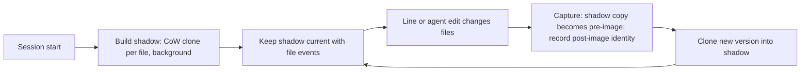

# Checkpoints: best-effort undo and redo

Checkpoints make most agent file changes reversible. They are best-effort: the engine detects when it cannot be sure what a file should be, and then refuses to restore rather than overwrite something it did not record. Data structures are in [../05-models/checkpoint.md](../05-models/checkpoint.md).

## Taking checkpoints

| ID | Requirement |
| --- | --- |
| FR-CKP-01 | **Shadow:** when an agent session starts, `knshd` must build a shadow of each checkpoint root by cloning file by file with copy-on-write, in the background. |
| FR-CKP-02 | While `checkpoints.required = true`, agent lines that touch a root must wait until its shadow is complete, or fail with `-32010` if the caller does not wait. |
| FR-CKP-03 | **Keeping current:** file-system events must keep the shadow in step with the live tree. |
| FR-CKP-04 | When the system reports dropped events, the affected folder must be rescanned, and checkpoints taken in that window must be marked **uncertain** (`checkpoint.uncertain`). |
| FR-CKP-05 | **Attribution:** changes made while a supervised line runs must be attributed to it (`command`). |
| FR-CKP-06 | Changes made inside an envelope outside any supervised line must become **agent edits** (`agent_edit`) and emit `agent.edit`. |
| FR-CKP-07 | Overlapping lines in one root must form a **concurrent set** (`concurrent`), undone together. |
| FR-CKP-08 | **Capture:** after each line or agent edit, for every changed path the shadow copy must move into the checkpoint as the pre-image (or a marker that the file did not exist). |
| FR-CKP-09 | The engine must record a **post-image identity** for each changed path: inode, size, modification time, and a content hash for files under 64 MB. The new version is then cloned into the shadow. |
| FR-CKP-10 | Checkpoint cost must grow with the number of files changed, not with the size of the project. Nothing has to be predicted before a command runs. |
| FR-CKP-11 | `checkpoint.created` must be emitted for each checkpoint. |

**Shadow builder (KNSH-079).** One build per root that clones (`apfs-clone`), started when the agent session starts
(`session.start_agent`, `session.create`) and stopped when it ends; session start never waits for it. Per decision 15
it clones file by file on 4 threads at QoS utility, into a new owner-only folder `shadows/<session>/<root index>/` in
the root's store. Every entry is read with `lstat`: a symlink is cloned as the link (its target is never read or
entered), a folder is entered only if it is one, folders named in `checkpoints.exclude` are skipped at any depth (files
of that name are not), special files (sockets, FIFOs, devices) are skipped and listed, and the store and the engine
directories are never entered (a root may contain them). An entry removed during the build is skipped; any other error
fails the build, and the root becomes `none`. Each build's file count and duration are logged, and one over 10 s is
logged as an error (NFR-PERF-06). Roots whose store is `plain-copy` get no shadow yet (`none`). Shadows are not removed
when their session ends yet (retention, KNSH-087).
**Known limit (pending):** the walk goes by path, so a folder swapped for a symlink between its `lstat` and its
listing (by a writer racing the build, such as the envelope) is still followed for that folder; an `openat`-relative
walk with `O_NOFOLLOW` closes this, and restore (KNSH-08x) must not trust shadow contents until it does.

**Lines that touch a root (FR-CKP-02).** A line touches a root when its `cwd` is in the root, or the profile's
`fs.write` holds a path in the root or one containing it: lines are sandboxed to `fs.write`, so a line meeting neither
cannot change the root. A required root that will never have a shadow denies the line before any waiting.

**Keeping current (KNSH-080, FR-CKP-03, FR-CKP-04, FR-EVT-08).** Each root with a shadow has one FSEvents stream
(file-level events, `WatchRoot`) on the root and on its marker folder `markers/<session>/<root index>/` in the root's
store, started **before** the shadow build so changes made while it runs are kept and applied once it completes, and
stopped when the session ends. The stream's thread only records which paths may have changed, coalesced to one entry
per path and at most 8,192 paths per root; more collapse into one rescan of the whole root (`too_many_events`). A
worker thread brings the shadow in step: each path's live entry and shadow copy are compared by kind, size and
modification time (flags are only hints, decision 16), a changed file or symlink is cloned again, a removed entry is
removed from the shadow (a folder with everything below it), a folder created or moved in is reconciled with
everything below it, and excluded folders, the store, the engine folders and special files are never shadowed. Each
path that really changed is published as `file.changed` on the session, whoever changed it. While the root itself is
gone or not a folder, the shadow keeps its last known state. Capture (KNSH-082) will take each changed path's shadow
copy as its pre-image before this replaces it.

**Lost events (FR-CKP-04).** `MustScanSubDirs`, `UserDropped` or `KernelDropped` rescans the folder named (the root,
as observed); on the marker folder, `EventIdsWrapped` and `RootChanged` (after checking the root is still a folder)
rescan the whole root. Each starts a new **uncertain window**. A line takes the window when it starts and compares it
when it ends: if it moved, `checkpoint.uncertain` is published with the line's `record_id` after its
`command.finished`. A window that opens while no line runs is published at once with `record_id: null` (the agent
edits of that window). A shadow update that fails also makes the window uncertain (`shadow_update_failed`).

**Closing a line (decision 16).** Once the supervisor has reaped a line, for each protected root it touches, the
watcher creates a marker file in the marker folder and flushes the stream every millisecond until the marker's event
arrives (so every earlier event of the line has too), a drop arrives, or 1 s passes on the clock; it then waits, within
the same second, until the worker has applied everything received. A drop, a missing marker (`flush_timed_out`) or a
root without a running watcher (`not_watched`) makes the line's checkpoints uncertain. This is the only place the
decision path waits for the watcher.

**Restart (NFR-REL-04).** A watcher can take over a shadow an earlier `knshd` run left: it rescans the whole root
against it and publishes the gap as `checkpoint.uncertain` (`restart_gap`). **Pending:** sessions do not survive a
`knshd` restart yet, so `knshd` has no shadow to take over after one; the takeover is wired when agent sessions are
re-adopted after a restart.

**Attribution (KNSH-081, FR-CKP-05 to FR-CKP-07).** `knshd` keeps one attribution ledger for all sessions, keyed by
root, so a line of one session in a root another session also protects is never the other's agent edit. Each change
the watcher applies is attributed by when it was applied and which root it is in:

| While | Attribution | Edge |
| --- | --- | --- |
| One supervised line runs in the root | `command` | That line's; closes when it ends |
| Two or more lines overlap in time in the root | `concurrent` | One set holding every overlapping line, transitively and across roots through a line touching several; closes when the last of them ends, and is undone as one |
| No line runs, and an envelope session protects the root | `agent_edit` | One run of agent edits; closes when the next line in the root starts or the last envelope session ends. Each batch the watcher applies is published as `agent.edit {root, paths, omitted}` on each envelope session protecting the root, at most 256 paths per event |
| No line runs, and no envelope session protects the root (only `session.create` sessions) | `external` | One run; closes when an envelope session or a line arrives, or the last session protecting the root ends; never offered for agent undo |

A change reported once no session protects the root and no line runs there (the last batch of a watcher stopped with
its session) belongs to nobody and is dropped. When sessions share a root, each has its own watcher and each reports a
line's changes: the line-end procedure therefore also flushes the other sessions' watchers of the line's roots (within
the flush deadline each, their uncertainty staying their own), so none reports a change of the line after it ended.

A line's record gets its `attribution` (`command` or `concurrent`) only after the line-end procedure has applied every
event of the line, so it is final and always equals the attribution of the closed edge that holds the line. A denied
line has none. An edge lists at most 65,536 paths and is then marked overflowed. Closed edges are what capture
(KNSH-082) and the history tree (KNSH-083) store; until those exist they are dropped, and only records carry the
attribution.
**Known limit:** opening a line never waits for the watcher (decision 16), so a change made just before the line whose
event had not been applied yet is attributed to the line.

File events carry no process ID, so a human edit made at the same moment can be attributed to the agent; the post-image check below keeps that from causing damage.

## Restore rules

| ID | Requirement |
| --- | --- |
| FR-CKP-20 | Undo and redo must restore a path only if the live file still matches its recorded post-image identity. Otherwise the path is a conflict and nothing changes (`-32004`). |
| FR-CKP-21 | `force` must exist only on `user.sock` and for the authority, never on `agent.sock`. |
| FR-CKP-22 | Restoring must write the old contents into the existing file, so its inode, hard links and open descriptors stay valid. |
| FR-CKP-23 | The modification time must be set to now, so build tools notice the change. |
| FR-CKP-24 | Files that were open for writing or memory-mapped during the change, and SQLite databases with journal files, must be marked **possibly torn** and not restored without `force`. |
| FR-CKP-25 | `checkpoint.restored` must be emitted after a restore. |

## History tree

States form a tree, like commits. Each line, agent edit or concurrent set is an edge from one state to the next. Undo moves back along an edge and keeps the branch it left, so redo stays possible until retention removes it.

| Operation | Effect | Endpoints |
| --- | --- | --- |
| `checkpoint.undo {record_id}` | Restores that change's pre-images, after saving the current versions so redo is possible | all (own session on `agent.sock`) |
| `checkpoint.redo {record_id}` | Restores the versions saved by the matching undo | all (own session on `agent.sock`) |
| `checkpoint.restore {state_id}` | Returns every root to an earlier state, undoing all later changes at once | `user.sock` and authority only |
| `checkpoint.diff {record_id \| state_id}` | Lists paths and returns per-file diffs between two states | all |

| ID | Requirement |
| --- | --- |
| FR-CKP-30 | Older changes may be undone only if no later change touched the same paths; otherwise the call must return the conflicting paths. |
| FR-CKP-31 | **Excluded paths** (`checkpoints.exclude`, default `node_modules`, `target`, `.venv`, `dist`, `build`) are not protected; undo must list them as not restored. |
| FR-CKP-32 | **Retention** must keep checkpoints until the first limit is reached: 5 GB of checkpoint data per volume, 200 checkpoints per root, or 7 days. |
| FR-CKP-33 | **Sensitive files:** pre-images of files matching sensitive patterns (`.env*`, `*.pem`, `*.key`, `id_*`) must be kept for 24 hours at most. |
| FR-CKP-34 | `knsh forget --with-checkpoints` must remove checkpoints at once. |
| FR-CKP-35 | **Other volumes:** checkpoints must sit on the same volume as the files they protect. Roots on non-APFS volumes must fall back to plain copies, limited to 50 MB per change, and the capability report must say so. |
| FR-CKP-36 | Undo of a flagged irreversible change must still restore its files, and its result must list what cannot be undone. |

Undoing an `npm install`, for example, leaves `node_modules` out of step with the lockfile until install runs again. A file the agent deleted, including one holding secrets such as `.env`, stays in its checkpoint until retention removes it.
