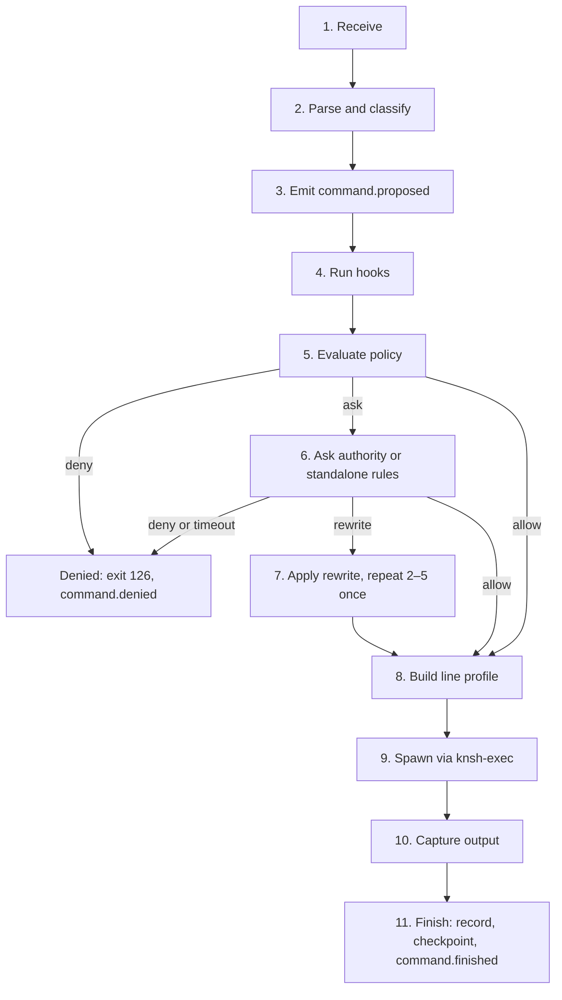

# Agent command lifecycle

Every agent command line goes through the supervisor in `knshd`. The whole line is decided before any part of it runs.

## Steps

| Step | ID | Requirement |
| --- | --- | --- |
| 1. Receive | FR-LC-01 | The supervisor must receive the line, working directory, environment and stdio descriptors from the client. |
| 2. Parse | FR-LC-02 | The supervisor must parse the whole line with a bash grammar. |
| | FR-LC-03 | For each simple command it must resolve the binary to an absolute, canonical path. |
| | FR-LC-04 | It must unwrap known wrappers: `env`, `command`, `exec`, `nice`, `nohup`, `time`, `timeout`, `xargs`. |
| | FR-LC-05 | It must mark **dynamic code**: `eval`, `source` of agent-writable files, `sh -c`, `bash -c`, interpreters with `-c` or `-e`, command names taken from variables, and anything the parser cannot read with confidence (decision 6). |
| | FR-LC-06 | It must classify network intent and irreversibility ([irreversible actions](irreversible-actions.md)). |
| 3. Emit | FR-LC-07 | The supervisor must emit `command.proposed`. |
| 4. Hooks | FR-LC-08 | The supervisor must run matching hooks ([hooks](hooks.md)). |
| 5. Policy | FR-LC-09 | Policy must be evaluated for the whole line before anything runs: deny if any part is denied, ask if any part asks ([policy](policy.md)). |
| 6. Ask | FR-LC-10 | If the verdict is ask, the supervisor must ask the authority, or apply standalone rules when none is connected ([reliability](../04-non-functional-requirements/reliability.md)). |
| 7. Rewrite | FR-LC-11 | If a rewrite was returned, the supervisor must apply it and repeat steps 2 to 5 once on the new line ([authority](authority.md#rewrites)). |
| 8. Profile | FR-LC-12 | The line's profile must be the session's per-command baseline plus whatever its classes, grants and approvals add ([sandbox profiles](sandbox-profiles.md)). |
| 9. Spawn | FR-LC-13 | The supervisor must re-serialise the line with every command's resolved absolute path and run it through `knsh-exec`, attached to the caller's stdio descriptors. |
| | FR-LC-14 | The interpreter must be the one the caller asked for: `sh` runs `/bin/sh` (bash in POSIX mode on macOS), `zsh` runs zsh, and `bash` or `knsh -c` run the profile's bash. Policy must not depend on which interpreter was asked for. |
| | FR-LC-15 | The sandbox's executable rules must allow only trusted binary folders and paths the profile names, so a binary swapped after classification cannot run. |
| | FR-LC-16 | Supervised lines must run without the shims, so any shell they start runs directly under the same profile. |
| | FR-LC-17 | The supervisor must emit `command.started`, and `command.long_running` if the line is still running after 30 s (configurable). |
| 10. Capture | FR-LC-18 | The supervisor must capture output, redact secrets, and emit `command.output` when the session records output. |
| 11. Finish | FR-LC-19 | The supervisor must write the record, compute file changes and the checkpoint ([checkpoints](checkpoints.md)), then emit `command.finished` and reply. |

**Re-serialisation (FR-LC-13).** `knsh-bash`'s `reserialise` replaces the name word of every command that resolved to
a binary (trusted or project executable), at any depth (wrapped commands, compound commands, function bodies,
substitutions, here-document substitutions), by the binary's canonical absolute path, and changes nothing else. A path
outside `[A-Za-z0-9/._+-]` is single-quoted (`'` written `'\''`). Builtins, calls to functions of the line, names not
found and dynamic parts stay as written; a line the parser could not read is returned unchanged and decided as dynamic
code. The output is parsed again and must keep the line's shape. Any of these is an error, and the line is denied:
a path that is not UTF-8, not absolute and canonical, or that holds a control character, backslash or backtick; a path
holding the replacement string of an `xargs` that runs the command (GNU `xargs -I` replaces it in the utility's name
too); a function of the line named exactly like the path (bash calls it for that name before any binary); a name
inside a backtick substitution bash un-escapes (`` `ls \$HOME` ``), whose place on the line is not exact; a changed
shape. Known effects: a program run by its canonical path sees that path as `argv[0]`, so a multi-call binary reached
through a symlink (`clang++` linking to `clang-18`, `view` to `vim`) behaves as its target; and a call the parser is
not certain reaches a function of the line is resolved and replaced as a program.

## Denial

| ID | Requirement |
| --- | --- |
| FR-LC-30 | A denied line must never start. |
| FR-LC-31 | The client must exit with code 126 and print the reason on stderr. |
| FR-LC-32 | The supervisor must emit `command.denied` with the matching rule, and record the denial ([execution records](execution-records.md)). |

## Timeouts

| ID | Requirement |
| --- | --- |
| FR-LC-40 | A line that exceeds its `timeout_s` must be killed and the call must fail with `-32008`, carrying the `record_id`. |
| FR-LC-41 | If the caller disconnects while a decision is pending, the request must be cancelled (`decision.cancelled`) and the line must not run. |
