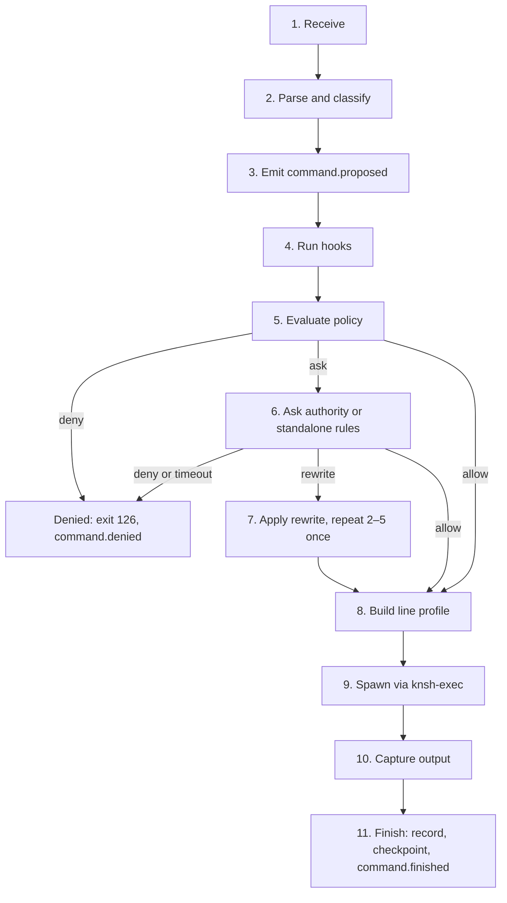

# Agent command lifecycle

Every agent command line goes through the supervisor in `knshd`. The whole line is decided before any part of it runs.

## Steps

| Step | ID | Requirement |
| --- | --- | --- |
| 1. Receive | FR-LC-01 | The supervisor must receive the line, working directory, environment and stdio descriptors from the client. |
| 2. Parse | FR-LC-02 | The supervisor must parse the whole line with a bash grammar. |
| | FR-LC-03 | For each simple command it must resolve the binary to an absolute, canonical path. |
| | FR-LC-04 | It must unwrap known wrappers: `env`, `command`, `exec`, `nice`, `nohup`, `time`, `timeout`, `xargs`. |
| | FR-LC-05 | It must mark **dynamic code**: `eval`, `source` of agent-writable files, `sh -c`, `bash -c`, interpreters with `-c` or `-e`, command names taken from variables, and anything the parser cannot read with confidence (decision 6). |
| | FR-LC-06 | It must classify network intent and irreversibility ([irreversible actions](irreversible-actions.md)). |
| 3. Emit | FR-LC-07 | The supervisor must emit `command.proposed`. |
| 4. Hooks | FR-LC-08 | The supervisor must run matching hooks ([hooks](hooks.md)). |
| 5. Policy | FR-LC-09 | Policy must be evaluated for the whole line before anything runs: deny if any part is denied, ask if any part asks ([policy](policy.md)). |
| 6. Ask | FR-LC-10 | If the verdict is ask, the supervisor must ask the authority, or apply standalone rules when none is connected ([reliability](../04-non-functional-requirements/reliability.md)). |
| 7. Rewrite | FR-LC-11 | If a rewrite was returned, the supervisor must apply it and repeat steps 2 to 5 once on the new line ([authority](authority.md#rewrites)). |
| 8. Profile | FR-LC-12 | The line's profile must be the session's per-command baseline plus whatever its classes, grants and approvals add ([sandbox profiles](sandbox-profiles.md)). |
| 9. Spawn | FR-LC-13 | The supervisor must re-serialise the line with every command's resolved absolute path and run it through `knsh-exec`, attached to the caller's stdio descriptors. |
| | FR-LC-14 | The interpreter must be the one the caller asked for: `sh` runs `/bin/sh` (bash in POSIX mode on macOS), `zsh` runs zsh, and `bash` or `knsh -c` run the profile's bash. Policy must not depend on which interpreter was asked for. |
| | FR-LC-15 | The sandbox's executable rules must allow only trusted binary folders and paths the profile names, so a binary swapped after classification cannot run. |
| | FR-LC-16 | Supervised lines must run without the shims, so any shell they start runs directly under the same profile. `knshd` removes every `PATH` entry naming the shim directory (trailing slashes ignored) when it receives the line, before names are resolved, and removes the session token variable (KNSH-049). |
| | FR-LC-17 | The supervisor must emit `command.started`, and `command.long_running` if the line is still running after 30 s (configurable). |
| 10. Capture | FR-LC-18 | The supervisor must capture output, redact secrets, and emit `command.output` when the session records output. |
| 11. Finish | FR-LC-19 | The supervisor must write the record, compute file changes and the checkpoint ([checkpoints](checkpoints.md)), then emit `command.finished` and reply. |

**Re-serialisation (FR-LC-13).** `knsh-bash`'s `reserialise` replaces the name word of every command that resolved to
a binary (trusted or project executable), at any depth (wrapped commands, compound commands, function bodies,
substitutions, here-document substitutions), by the binary's canonical absolute path, and changes nothing else. A path
outside `[A-Za-z0-9/._+-]` is single-quoted (`'` written `'\''`). Builtins, calls to functions of the line, names not
found and dynamic parts stay as written; a line the parser could not read is returned unchanged and decided as dynamic
code. The output is parsed again and must keep the line's shape. Any of these is an error, and the line is denied:
a path that is not UTF-8, not absolute and canonical, or that holds a control character, backslash or backtick; a path
holding the replacement string of an `xargs` that runs the command (GNU `xargs -I` replaces it in the utility's name
too); a function of the line named exactly like the path (bash calls it for that name before any binary); a name
inside a backtick substitution bash un-escapes (`` `ls \$HOME` ``), whose place on the line is not exact; a changed
shape. Known effects: a program run by its canonical path sees that path as `argv[0]`, so a multi-call binary reached
through a symlink (`clang++` linking to `clang-18`, `view` to `vim`) behaves as its target; and a call the parser is
not certain reaches a function of the line is resolved and replaced as a program.

## Spawning (KNSH-051)

- **Profile.** The session's profile is compiled for the line (tagged with its record), allowing exec only of the
  trusted and system tool folders, the profile's bash and the binaries the line resolved to (FR-LC-15), and written
  to its private file. A profile file that cannot be written means nothing starts.
- **Interpreter.** `sh` runs `/bin/sh`, `zsh` runs `/bin/zsh`, `bash` and `knsh -c` run `exec.bash` (`/bin/bash` by
  default).
- **Start.** `knsh-exec` runs as the leader of a new process group, in the line's `cwd`, on the caller's three
  descriptors (or `/dev/null` until output capture, KNSH-053), with the environment `knshd` received and nothing
  added, with the line's operands as `--arg`. `knshd` never applies a sandbox itself. `command.started` follows the
  spawn. The dynamic linker's `DYLD_*` variables are removed: `knsh-exec` runs unsandboxed until it becomes
  `sandbox-exec`, so a library they name would run outside the line's profile (the SIP-protected interpreters drop
  them anyway). An empty line runs as `:` (`knsh-exec` refuses an empty `--line`; both run nothing and exit 0).
- **Watch.** `knshd` holds the group (its leader unreaped) until the line ends, so it never signals a reused id.
  `command.long_running` is published once after 30 s. At `timeout_s` the group gets `SIGTERM`, then `SIGKILL` after
  2 s; once the leader has exited, the group is killed again before the leader is reaped, so no member outlives a
  timed-out line. The call then fails with `-32008` carrying the `record_id`, and the record's `signal` is set.
  Members left behind by a line that ended on its own are not stopped; a process that leaves the group is out of
  reach.
- **Not started.** `knsh-exec` reports its own failures on a status pipe (`--status-fd`,
  [process model](../02-architecture/process-model.md#knsh-exec)). A failure there, or a `knsh-exec` that cannot be
  started, means the line never ran: the call fails with `-32603`, the record has neither exit code nor signal, and the
  failure is logged.
- **Not yet.** No proxy is wired (KNSH-059): lines are compiled without a proxy port, so their network is closed except
  the profile's loopback ports, and no per-command proxy credentials are given.

## Output capture (KNSH-053)

A line's output is captured (step 10, FR-LC-18) when its caller did not pass stdio (`exec.run` and `exec.start` from
an agent that integrates natively), or when its session's profile records output (`recording.output`). Otherwise
(`knsh -c` in a session that does not record output) the line runs on the caller's descriptors and `knshd` never sees
its output (FR-OUT-04).

- **Pipes.** stdout and stderr are pipes read by `knshd`, one thread per stream; stdin is the caller's, or
  `/dev/null` for a captured `exec.run`. For `knsh -c`, each chunk is first written unchanged to the caller's own
  descriptor (a tee), so the caller sees what it would have seen; if that write fails, the pipe is closed and the line
  gets `EPIPE` as it would have. Teeing puts `knshd` in the data path: the line's stdout and stderr are pipes, not the
  caller's terminal (latency to confirm in KNSH-076).
- **Redaction hook.** Every chunk then passes the redaction hook (FR-EVT-07, FR-OUT-06) before it is kept, returned,
  stored or emitted. It does nothing until secret redaction arrives (KNSH-091); a secret split across two chunks will
  need handling then.
- **Cap.** Each stream is kept within 1 MB as it is read: the first half and the last half, with the size written,
  the bytes skipped and where (FR-REC-06), and the line count.
- **Storage and events.** Only when the profile records output is the capture stored with the record and published
  as `command.output` ([event](../05-models/event.md)). With `recording.output = false` (the default) nothing is
  stored and nothing is emitted.
- **End.** Once the leader is reaped, the readers get at most 250 ms to reach end of file (a background process the
  line left behind may hold the pipe), then the capture is final: later bytes are still drained and teed, so the
  leftover process never blocks, but are neither kept nor published.

## The decision pipeline (KNSH-050)

Steps 2 to 8 are one pure function in `knsh-core` (`decide`); a driver in `knshd` performs the effects around it
(events, the record, the spawn). Hooks, the authority, standalone approvals and the spawner are interfaces, so the
whole lifecycle is tested with fakes. How the steps combine:

- **One pass per line.** Each line evaluated (the received one, then a rewritten one) is parsed and classified, gets
  its own `command.proposed` (published before its hooks run), its hooks and its policy evaluation. A rewritten line's
  `command.proposed` carries `rewritten_from`.
- **Rewrites.** A rewrite from a hook or from the authority starts the second pass; it is the line's one rewrite.
  Policy is never evaluated on the line a hook rewrote, only on the new one (FR-HOOK-11). A second rewrite, from
  either, denies the line (FR-AUTH-31), as does a rewrite of a line holding a redaction marker, or one carrying the
  marker (FR-AUTH-32), or one longer than 65536 bytes or holding NUL.
- **Combining.** A hook `deny` or failure denies with source `hook` before policy runs. Otherwise the strictest of the
  hooks' verdict and policy's wins (FR-HOOK-12): a hook `ask` on a line the rules allow is asked about with no
  `rule_id`. Under the `unattended` profile any ask, a hook's included, is a deny with source `standalone`.
- **Asks.** With an authority connected the source of the answer is `authority`, including its timeout. Without one,
  standalone handling holds the request: approved locally (source `user`) or denied at the timeout (source
  `standalone`, `-32002`).
- **Failures deny.** A hook failure, an ask that fails, a line that cannot be re-serialised (FR-LC-13), and a panic
  anywhere in the pipeline are denials. Before the pipeline runs, the driver also denies a line it cannot record (no
  record store, no clock), and one whose session profile cannot be loaded.
- **Cancellation (FR-LC-41).** The caller is checked after the hooks, while an ask waits, after the ask, and once more
  right before the spawn. A cancelled line is answered `-32011`, publishes `decision.cancelled` (`caller_gone`), is
  recorded as a deny with source `standalone`, and publishes `command.denied`. A line whose ask timed out publishes
  `decision.cancelled` (`timed_out`) the same way and is answered `-32002`.
- **Every line is recorded.** Denied, cancelled and timed-out lines are recorded before `command.denied` is published
  (FR-REC-03); an allowed line is recorded after it ends, then `command.finished` is published (FR-LC-19). The
  record's `decision` is the pipeline's decision with its latency.

## Denial

| ID | Requirement |
| --- | --- |
| FR-LC-30 | A denied line must never start. |
| FR-LC-31 | The client must exit with code 126 and print the reason on stderr. |
| FR-LC-32 | The supervisor must emit `command.denied` with the matching rule, and record the denial ([execution records](execution-records.md)). |

## Timeouts

| ID | Requirement |
| --- | --- |
| FR-LC-40 | A line that exceeds its `timeout_s` must be killed and the call must fail with `-32008`, carrying the `record_id`. |
| FR-LC-41 | If the caller disconnects while a decision is pending, the request must be cancelled (`decision.cancelled`) and the line must not run. |
