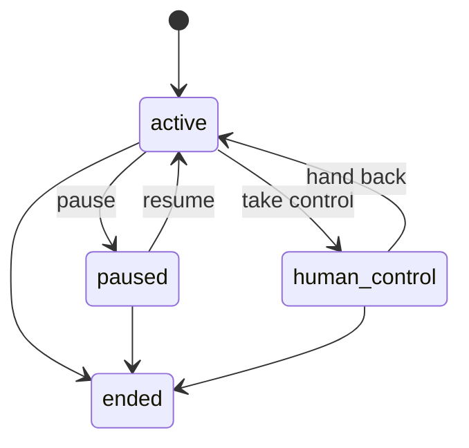

# Sessions

Every command runs in a session with exactly one actor, fixed at start. Agent commands are decided on as a whole line before any part of it runs; human commands are only observed. Session fields are defined in [../models/session.md](../models/session.md).

## Creation

| ID | Requirement |
| --- | --- |
| FR-SES-01 | Every session must have exactly one actor (`human` or `agent`), fixed at start. |
| FR-SES-02 | Agent sessions must be created only over `user.sock` (`knsh agent`) or by the authority. A process inside an envelope cannot create sessions. |
| FR-SES-03 | A session started from inside another one must record `parent_session_id` and inherit its profile or a stricter one. |
| FR-SES-04 | Recording must be off by default for human sessions and on by default for agent sessions ([privacy](../nonfunctional-requirements/privacy.md)). |

## States

| ID | Requirement |
| --- | --- |
| FR-SES-10 | **Paused:** the supervisor must hold new commands (`-32007`) and send `SIGSTOP` to the envelope's and each running command's process groups; resuming must send `SIGCONT`. |
| FR-SES-11 | A process that has left its group with `setsid` keeps running while paused, still sandboxed. This is accepted behaviour. |
| FR-SES-12 | **Human control:** the human works in their own session; the agent's commands must be held (`-32007`) until control is handed back. Nothing typed into an envelope is treated as human. |
| FR-SES-13 | Sessions must be paused when the pushed policy they use expires ([policy](policy.md)). |
| FR-SES-14 | Every state change must emit `session.state_changed`. |

## Human sessions

| ID | Requirement |
| --- | --- |
| FR-SES-20 | Human sessions must run stock zsh or bash in integration mode ([terminals and shells](../integrations/terminals-and-shells.md)). |
| FR-SES-21 | When recording is on, `preexec` and `precmd` hooks must record commands as telemetry. |
| FR-SES-22 | Nothing in a human session may be decided, rewritten or blocked, and these hooks are never relied on for security. |
| FR-SES-23 | Human sessions with recording off must not start `knshd`. |
| FR-SES-24 | `session.idle` must be emitted when a human prompt has waited for input for 5 seconds. |
| FR-SES-25 | A recording session must set `KNSH_RECORDING=1` and report `recording` in `session.info`, so prompts and clients can show it. |
