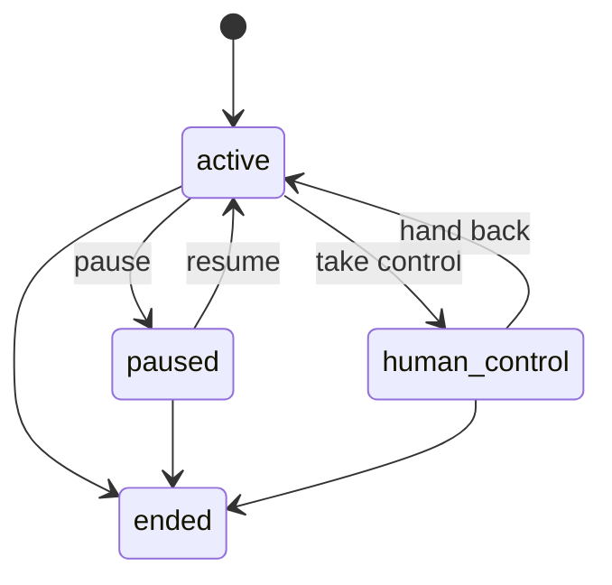

# Sessions

Every command runs in a session with exactly one actor, fixed at start. Agent commands are decided on as a whole line before any part of it runs; human commands are only observed. Session fields are defined in [../05-models/session.md](../05-models/session.md).

## Creation

| ID | Requirement |
| --- | --- |
| FR-SES-01 | Every session must have exactly one actor (`human` or `agent`), fixed at start. |
| FR-SES-02 | Agent sessions must be created only over `user.sock` (`knsh agent`) or by the authority. A process inside an envelope cannot create sessions. |
| FR-SES-03 | A session started from inside another one must record `parent_session_id` and inherit its profile or a stricter one. |
| FR-SES-04 | Recording must be off by default for human sessions and on by default for agent sessions ([privacy](../04-non-functional-requirements/privacy.md)). |

## States

| ID | Requirement |
| --- | --- |
| FR-SES-10 | **Paused:** the supervisor must hold new commands (`-32007`) and send `SIGSTOP` to the envelope's and each running command's process groups; resuming must send `SIGCONT`. |
| FR-SES-11 | A process that has left its group with `setsid` keeps running while paused, still sandboxed. This is accepted behaviour. |
| FR-SES-12 | **Human control:** the human works in their own session; the agent's commands must be held (`-32007`) until control is handed back. Nothing typed into an envelope is treated as human. |
| FR-SES-13 | Sessions must be paused when the pushed policy they use expires ([policy](policy.md)). |
| FR-SES-14 | Every state change must emit `session.state_changed`. |

**Holding a line (KNSH-049, KNSH-054).** `exec.*` answers `-32007` at once, with `data.state`, rather than blocking
the call. `knsh -c` then stays held: it prints one notice on stderr the first time, waits one second, and sends the
same line again on the same connection, until the answer is something else. It never exits with an error because a
line was held; the agent sees a slow command. The agent CLI's own tool timeout, which kills `knsh`, is what bounds the
wait.

**Pausing and taking control (KNSH-054).**

- A held line is answered before anything else and is not recorded: it was never proposed. The session is checked
  again after the decision, which may have waited on an ask: a line allowed for a session that was paused or taken
  over meanwhile does not start, is recorded as a deny (reason: held after the decision) and is answered `-32007`.
- The supervisor keeps a handle on each of the session's process groups (its envelope's and each running line's): the
  group id together with the unreaped leader it holds. A line's handle is dropped before its leader is reaped, so a
  pause never signals an id that may have been reused. A pause stops the envelope's group first, then the lines';
  a resume continues the lines first, then the envelope.
- A line spawned in the instant between the second check and a pause is stopped as soon as its group is kept.
- Human control stops nothing: lines already running go on to their end; only new lines are held. A line that
  passed the second check an instant before control was taken still runs, like one already running.
- Time a line spends paused does not count towards its `timeout_s`.
- A session that ends while paused gets `SIGCONT` on every group still kept, so nothing it started stays stopped.
- A refused transition (pausing a paused session, resuming an active one, any transition of an ended or unknown
  session) is `-32006` with `data.session_id`; the state is unchanged and no event is emitted.

## Human sessions

| ID | Requirement |
| --- | --- |
| FR-SES-20 | Human sessions must run stock zsh or bash in integration mode ([terminals and shells](../08-integrations/terminals-and-shells.md)). |
| FR-SES-21 | When recording is on, `preexec` and `precmd` hooks must record commands as telemetry. |
| FR-SES-22 | Nothing in a human session may be decided, rewritten or blocked, and these hooks are never relied on for security. |
| FR-SES-23 | Human sessions with recording off must not start `knshd`. |
| FR-SES-24 | `session.idle` must be emitted when a human prompt has waited for input for 5 seconds. |
| FR-SES-26 | `knsh --native` must host `knsh`'s own interpreter (native mode) for that human session, whatever `[shell] hosted` says, without changing the configuration file. It never affects an agent line or a session in an envelope: their mode comes from the profile (FR-LC-50). |
| FR-SES-25 | A recording session must set `KNSH_RECORDING=1` and report `recording` in `session.info`, so prompts and clients can show it. |
