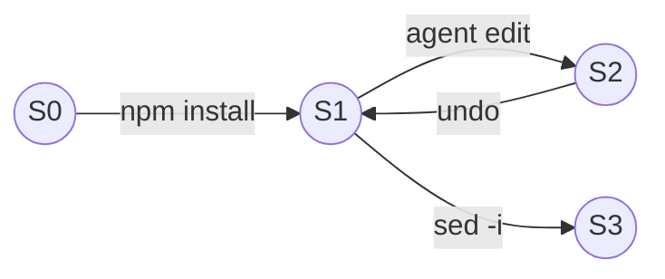

# Checkpoint

Behaviour is in [../03-functional-requirements/checkpoints.md](../03-functional-requirements/checkpoints.md).

## Concepts

| Concept | Description |
| --- | --- |
| **Checkpoint root** | A folder protected by checkpoints (`checkpoints.roots`, default `${PROJECT}`) |
| **Shadow** | A copy-on-write clone of each root, kept current with file events |
| **Checkpoint** | The pre-images of every path changed by one edge, with their post-image identities |
| **Pre-image** | The file's contents before the change, or a marker that it did not exist |
| **Post-image identity** | Inode, size, modification time, and a content hash for files under 64 MB |
| **State** | A node in the history tree: the contents of all roots at a point in time |
| **Edge** | One line, agent edit or concurrent set, from one state to the next |

## Checkpoint fields

| Field | Notes |
| --- | --- |
| `checkpoint_id` | ID |
| `record_id` | The record whose change it captures |
| `attribution` | `command`, `agent_edit`, `external` or `concurrent` |
| `paths` | Each changed path with pre-image reference and post-image identity |
| `uncertain` | True if taken while file events were dropped |
| `possibly_torn` | Paths that were open for writing or memory-mapped, or SQLite databases with journals |
| `excluded` | Paths under excluded folders, not protected |
| `irreversible` | Reasons copied from the record, listed on undo |

## History tree

Undo moves back along an edge and keeps the branch it left, so redo stays possible until retention removes it.

## Storage

| Volume | Location | Method |
| --- | --- | --- |
| Home volume (APFS) | `~/Library/Application Support/knsh/checkpoints/` | Copy-on-write clones |
| Other APFS volumes | `.knsh-checkpoints/` on that volume, when writable | Copy-on-write clones |
| Non-APFS volumes | Home store | Plain copies, limited to 50 MB per change |

## Retention

First limit reached: 5 GB per volume, 200 checkpoints per root, or 7 days. Sensitive patterns (`.env*`, `*.pem`, `*.key`, `id_*`): 24 hours at most.
