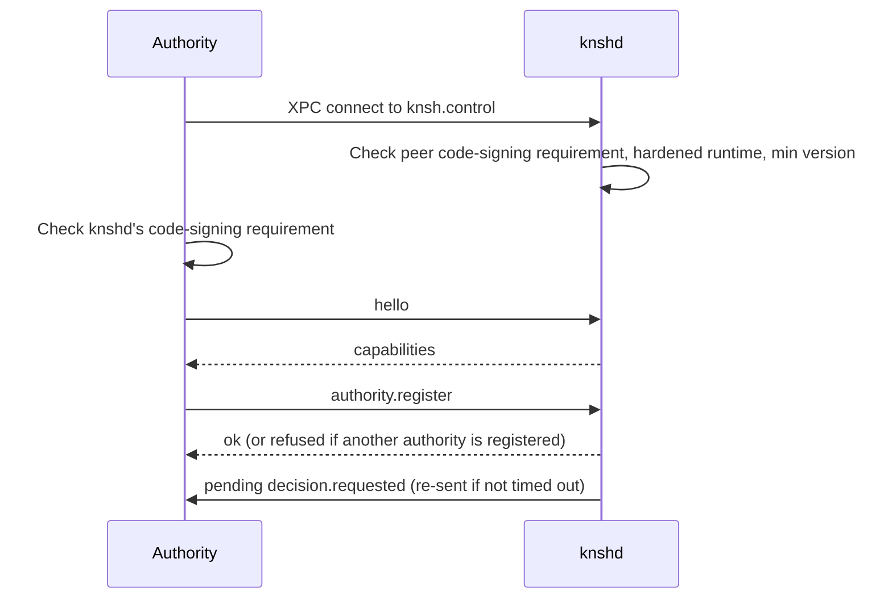

# Authority applications

An authority is a trusted client application that decides and presents: it approves or denies agent commands, pushes policy, creates grants, pauses and takes over sessions, and supplies secrets. The engine accepts one authority at a time and works fully without one. Requirements are in [../03-functional-requirements/authority.md](../03-functional-requirements/authority.md).

## Prerequisites

| Requirement | Detail |
| --- | --- |
| Signature | Developer ID or App Store signature |
| Hardened runtime | Required; checked on each connection |
| Entitlements | No debugging entitlement |
| Version | At or above the `--min-version` the user trusted |
| Trust | The user runs `knsh authority trust --team-id <id> --identifier <bundle-id> --min-version <v>` once, confirmed with Touch ID or password |

## Connection sequence

## Handling decisions

1. Receive `decision.requested` with the redacted command, cwd, matched rule, irreversibility and `timeout_at`.
2. Present it to the user, or decide automatically.
3. Reply with `decision.respond`: `allow`, `deny` or `rewrite` (with `command`), optionally with a `grant` (`scope`, `duration_s`) and a `reason`.
4. Respect `decision.cancelled`: the engine ignores late answers.

Guidance:

- Answer before `timeout_at`; at the timeout the request is denied.
- Use grants to reduce approval fatigue, scoped as narrowly as possible.
- Show `irreversible.reasons` prominently.
- A rewritten line that asks again arrives with `rewritten_from`; a second rewrite is refused.

## Pushing policy

- `policy.set` pushes a snapshot with `expires_at`. When it expires, sessions using it are paused until the authority returns or the user picks a local profile.
- `policy.get`, `policy.grant`, `policy.grants`, `policy.revoke` manage the rest.

## Secrets

`secrets.provide` supplies short-lived, narrowly scoped tokens held only in memory. Prefer these to long-lived Keychain secrets.

## Out of scope

A compromised authority is outside the threat model. The authority is fully trusted.
